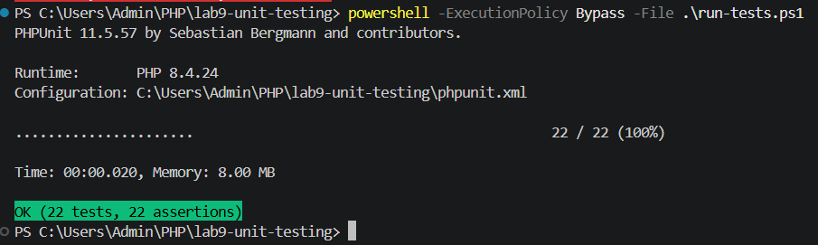
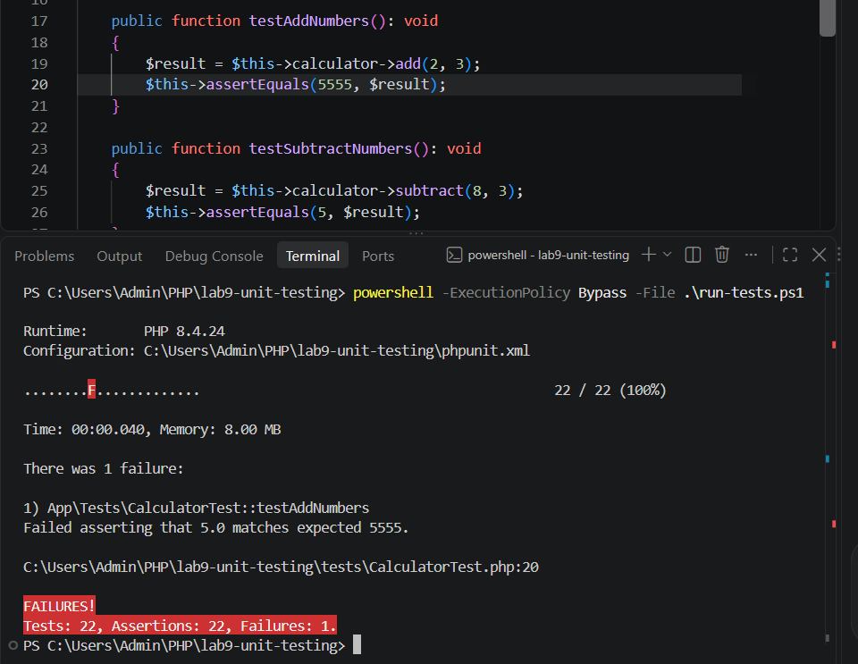

# Звіт — лабораторна робота №9

**Тема:** юніт-тестування коду мовою PHP  
**Виконав:** Адам Смеречук, ІПЗ-33, варіант 10

## Виконана робота

1. Створено навчальний приклад простих тестів для додавання та множення в `examples/simple_test.php`.
2. Налаштовано Composer і PHPUnit. Для проєкту додано `composer.json`, `composer.lock` та `phpunit.xml`.
3. Створено класи `Calculator` і `BankAccount` та тести для їхньої логіки.
4. До `Calculator` додано множення й віднімання та відповідні тести.
5. Створено `DiscountCalculator` і тести для типів клієнтів, межі суми та помилкових сум.
6. Для завдання 5 створено функцію `Variant10` за умовою з таблиці та тести для трьох гілок.

## Результати запуску

Команда для запуску тестів у цьому середовищі Windows:

```powershell
powershell -ExecutionPolicy Bypass -File .\run-tests.ps1
```

Результат після повернення правильного очікуваного значення та додавання тестів для варіанта 10:

```text
PHPUnit 11.5.57
OK (22 tests, 22 assertions)
```

Для демонстрації помилки очікуване значення в тесті додавання тимчасово змінювалося з `5` на `5555`. PHPUnit показав невідповідність: фактично отримано `5.0`, очікувалося `5555`. Значення було повернуто на `5`, після чого весь набір тестів пройшов.

## Скріншоти результатів

Успішний запуск тестів:



Навмисно змінене очікуване значення дало один невдалий тест:


